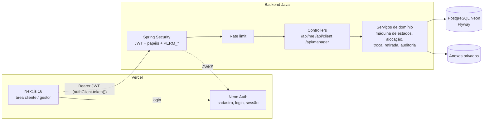

# JMF — Backend (Java / Spring Boot)

API de produção do sistema de aluguel de caçambas da JMF. Substitui os dados mock (`lib/jmf/mock-data.ts` e `mockJmfService`) por uma fonte única e persistente no PostgreSQL (Neon), com autenticação via **Neon Auth** e isolamento entre clientes e gestores.

| Item | Escolha |
|---|---|
| Runtime | Java 21, Spring Boot 3.5 (virtual threads) |
| Banco | PostgreSQL no Neon |
| Migrações | Flyway (`src/main/resources/db/migration`) |
| Persistência | Spring Data JPA / Hibernate (consultas parametrizadas) |
| Autenticação | JWT do Neon Auth (EdDSA/Ed25519) validado via JWKS |
| Validação | Jakarta Bean Validation + regras de domínio |
| Documentação | OpenAPI/Swagger UI (somente no perfil `dev`) |
| Testes | JUnit 5, MockMvc, Testcontainers (PostgreSQL real) |

> A especificação original sugeria Next.js Route Handlers + Drizzle. Este backend implementa o **mesmo contrato** (endpoints, regras, formatos de resposta) como um serviço Java separado, consumido pelo frontend Next.js atual. Veja `docs/DECISOES.md`.

## Arquitetura



Camadas (`src/main/java/br/com/jmf`):

- `security/` — validação do JWT (`NeonJwtDecoder`), provisionamento do usuário no primeiro acesso, papéis e permissões, rate limit.
- `web/` — controllers e DTOs (`Inputs` / `Views`).
- `service/` — regras de negócio: `RequestStateMachine`, `ClientService`, `RequestWorkflowService` (aprovar/avançar/alocar/trocar/retirar), `DumpsterService`, `ManagerQueryService`, `LocationService`, `AttachmentService`, `AuditService`, `NotificationService`, `SettingsService`.
- `domain/` — entidades JPA e repositórios.
- `common/` — envelope de resposta, erros, sanitização, telefone, CPF.

## Executar localmente

Pré-requisitos: JDK 21, Maven 3.9+, Docker.

```bash
docker compose up -d                       # PostgreSQL local
export SPRING_DATASOURCE_URL=jdbc:postgresql://localhost:5432/jmf
export SPRING_DATASOURCE_USERNAME=jmf SPRING_DATASOURCE_PASSWORD=jmf
mvn spring-boot:run -Dspring-boot.run.profiles=dev
```

O perfil `dev`:
- aplica as migrações **e** o seed de demonstração (`db/seed/R__dev_seed.sql`) — 30 caçambas, 3 clientes e 1 gestor;
- usa tokens HS256 locais (`jmf.auth.mode=hmac`) para testar sem o Neon Auth;
- habilita Swagger em `http://localhost:8080/swagger-ui.html`.

Gerar um token de teste e chamar a API:

```bash
TOKEN=$(curl -s -X POST localhost:8080/api/dev/token -H 'Content-Type: application/json' \
  -d '{"sub":"dev-gestor","role":"admin"}' | jq -r .data.token)
curl -s localhost:8080/api/manager/overview -H "Authorization: Bearer $TOKEN" | jq
```

Usuários do seed: `dev-gestor` (gestor), `dev-joao` e `dev-marcos` (clientes com caçamba ativa), `dev-camila` (solicitação pendente).

Para usar o Neon de verdade em desenvolvimento, basta exportar `DATABASE_URL`, `DATABASE_URL_UNPOOLED` e `NEON_AUTH_BASE_URL` e definir `JMF_AUTH_MODE=neon`.

## Variáveis de ambiente

As variáveis já existentes no projeto são reaproveitadas **sem duplicação** — a URL no formato `postgresql://...` é convertida para JDBC automaticamente.

| Variável | Uso | Obrigatória |
|---|---|---|
| `DATABASE_URL` (ou `POSTGRES_URL`) | Conexão da aplicação (pooled) | sim |
| `DATABASE_URL_UNPOOLED` (ou `POSTGRES_URL_NON_POOLING`) | Migrações Flyway (conexão direta) | sim |
| `NEON_AUTH_BASE_URL` | Deriva JWKS (`/.well-known/jwks.json`) e issuer (origem da URL) | sim (prod) |
| `SPRING_PROFILES_ACTIVE` | `prod` em produção/preview, `dev` local | sim |
| `JMF_CORS_ORIGINS` | Origens do frontend, separadas por vírgula | sim |
| `JMF_STORAGE_DIR` | Pasta privada dos anexos | sim (se houver anexos) |
| `JMF_AUTH_JWKS_URI`, `JMF_AUTH_ISSUER`, `JMF_AUTH_AUDIENCE` | Sobrescrevem os valores derivados | não |
| `JMF_ADMIN_ROLES` | Valores da claim `role` que tornam o usuário gestor (padrão `admin`) | não |
| `JMF_SERVICE_AREA_ENABLED`, `JMF_SERVICE_RADIUS_KM` | Área atendida (padrão: 80 km de São Luís, MA) | não |
| `DB_POOL_SIZE`, `PORT` | Ajustes de infraestrutura | não |
| `JMF_AUTH_MODE`, `JMF_DEV_JWT_SECRET` | **Somente dev/test** (`hmac` é recusado no perfil `prod`) | não |

`NEON_AUTH_COOKIE_SECRET` e `NEON_PROJECT_ID` continuam sendo usados apenas pelo frontend. Veja `.env.example`.

## Migrações e rollback

- Versionadas em `src/main/resources/db/migration` (`V1__schema_inicial.sql`) e aplicadas automaticamente no start, usando a conexão **direta** (`DATABASE_URL_UNPOOLED`).
- Seed de desenvolvimento separado em `db/seed`, carregado **apenas** no perfil `dev`.
- Rollback: o Flyway Community não executa *undo*. Antes de migrar produção, crie um **branch no Neon** (restauração instantânea). Para desfazer manualmente a V1: `psql "$DATABASE_URL_UNPOOLED" -f db/rollback/U1__schema_inicial.sql` (destrói dados).
- Novas mudanças: sempre um novo arquivo `V{n}__descricao.sql`; nunca editar uma migração já aplicada.

## Integração com o frontend

1. Copie `frontend-integration/http-service.ts` para `lib/jmf/http-service.ts` e troque `mockJmfService` por `httpJmfService`.
2. O token vem de `authClient.token()` (Neon Auth) e vai no header `Authorization: Bearer`.
3. Após o `signUp`, chame `PATCH /api/me` com o telefone digitado (`saveProfilePhone`). Sem telefone, criar solicitações retorna `422 PHONE_REQUIRED`.
4. Valores monetários vêm em **centavos** (`priceCents`, `weeklyPriceCents`).
5. Para abrir no Google Maps, use `location.mapsUrl` (gerado no servidor a partir das coordenadas persistidas).
6. O backend **rejeita** (400) payloads com campos desconhecidos, como `price` ou `customerId`.

## Endpoints

Todas as rotas exigem `Authorization: Bearer <jwt>`. Listagens aceitam `page` (0..) e `size` (1–100, padrão 20).

**Perfil** (qualquer usuário autenticado)

| Método | Rota | Descrição |
|---|---|---|
| GET | `/api/me` | Usuário, papel, permissões e perfil de cliente |
| PATCH | `/api/me` | Nome, telefone (normalizado para `+55DDNNNNNNNNN`), CPF opcional |
| GET | `/api/me/notifications?unreadOnly=` | Notificações do usuário |
| PATCH | `/api/me/notifications/{id}/read` | Marca como lida |

**Cliente** (`ROLE_CLIENTE`; tudo escopado pelo usuário do token)

| Método | Rota | Descrição |
|---|---|---|
| GET | `/api/client/dashboard` | Resumo, locações ativas, solicitações abertas, preço vigente |
| GET | `/api/client/rentals[/{id}]` | Histórico de locações |
| GET | `/api/client/requests[/{id}]` | Solicitações (detalhe inclui histórico de status) |
| POST | `/api/client/requests/rental` | Novo aluguel → `201` |
| POST | `/api/client/requests/swap` | Troca da caçamba ativa → `201` |
| POST | `/api/client/requests/removal` | Retirada → `201` |
| POST | `/api/client/requests/{id}/cancel` | Cancela solicitação ainda não atendida |
| POST | `/api/client/locations/resolve` | Valida/normaliza endereço (e geocodifica, se configurado) |
| POST/GET | `/api/client/attachments[/{id}]` | Upload (multipart `file`) / download de anexo próprio |

**Gestor** (`ROLE_GESTOR` + permissão indicada)

| Método | Rota | Permissão |
|---|---|---|
| GET | `/api/manager/overview` | — |
| GET | `/api/manager/requests?status=&type=&customerId=&q=&from=&to=&awaitingAction=` | — |
| GET | `/api/manager/requests/{id}` | — |
| PATCH | `/api/manager/requests/{id}/status` `{status, notes, sendToMaintenance}` | `REQUESTS_MANAGE` |
| POST | `/api/manager/requests/{id}/allocate` `{dumpsterId?}` | `REQUESTS_MANAGE` |
| POST | `/api/manager/requests/{id}/complete-swap` `{replacementDumpsterId?, sendOldToMaintenance}` | `REQUESTS_MANAGE` |
| GET | `/api/manager/dumpsters?status=&number=&customer=&available=` | — |
| POST | `/api/manager/dumpsters` | `FLEET_MANAGE` |
| PATCH | `/api/manager/dumpsters/{id}` | `FLEET_MANAGE` |
| GET | `/api/manager/customers?q=&status=` | `CUSTOMERS_VIEW` |
| GET | `/api/manager/rentals?status=&customerId=&dumpsterNumber=` | `RENTALS_VIEW` |
| GET | `/api/manager/map` (máx. 500 pontos) | `MAP_VIEW` |
| GET | `/api/manager/settings` | — |
| PATCH | `/api/manager/settings` | `SETTINGS_MANAGE` |
| GET | `/api/manager/attachments/{id}` | — |

### Contrato de resposta

```json
{ "data": { }, "meta": { "requestId": "req_9f2c..." } }
```
```json
{ "error": { "code": "VALIDATION_ERROR", "message": "Não foi possível concluir a solicitação.",
             "fields": { "phone": "Informe um telefone válido com DDD." } },
  "meta": { "requestId": "req_9f2c..." } }
```

Códigos: `400 VALIDATION_ERROR`, `401 UNAUTHENTICATED`, `403 FORBIDDEN`, `404 NOT_FOUND` (também para recurso de outro cliente), `409 CONFLICT | DUMPSTER_UNAVAILABLE | INVALID_TRANSITION`, `413 PAYLOAD_TOO_LARGE`, `422 BUSINESS_RULE | PHONE_REQUIRED | CUSTOMER_INACTIVE`, `429 RATE_LIMITED`, `500 INTERNAL_ERROR`. O header `X-Request-Id` é devolvido em todas as respostas e aparece nos logs.

## Papéis e permissões

- **Cliente**: qualquer usuário autenticado sem papel de gestor. O registro em `customers` é criado no primeiro acesso.
- **Gestor**: usuário cuja claim `role` do Neon Auth contém `admin` (mesmo critério de `hasJmfManagementAccess` no frontend) recebe **todas** as permissões. Outros gestores podem ser cadastrados no banco com permissões específicas:

```sql
update app_users set role = 'gestor' where email = 'operador@jmf.com.br';
insert into user_permissions (user_id, permission)
select id, unnest(array['REQUESTS_MANAGE','MAP_VIEW']) from app_users where email = 'operador@jmf.com.br';
```

## Máquina de estados

```
aluguel : pendente → aprovada → em_entrega → entregue → em_uso ─(retirada/troca)→ finalizada
troca   : troca_solicitada → em_troca → [complete-swap] → em_uso
retirada: retirada_solicitada → em_retirada → finalizada
gestor rejeita: pendente/aprovada (aluguel), troca/retirada antes da conclusão → rejeitada
cliente cancela: pendente/aprovada (aluguel), troca_solicitada, retirada_solicitada → cancelada
```

Efeitos: `em_entrega` aloca automaticamente a primeira caçamba livre se nenhuma foi alocada; `entregue` marca a caçamba como `ocupada` e abre a locação; a conclusão da troca encerra a locação antiga, libera a caçamba antiga (ou envia para manutenção) e ocupa a substituta no mesmo endereço; `finalizada` (retirada) encerra a locação e devolve a caçamba para `livre` ou `manutencao`.

## Testes

```bash
mvn test        # unitários + integração (os *IT exigem Docker para o Testcontainers)
```

- Unitários: máquina de estados, telefone, CPF, sanitização, endereço, conversão de URL do banco, verificação Ed25519.
- Integração (PostgreSQL real): autorização por papel e permissão, isolamento entre clientes, rejeição de preço/dono forjados, fluxo completo aluguel → troca → retirada, imutabilidade da auditoria e **concorrência** (duas alocações simultâneas da mesma caçamba → uma `200` e uma `409`).

## Pendências a confirmar (seção 14 da especificação)

- **Geocodificação**: ponto de extensão `GeocodingProvider` pronto; hoje desativado (o frontend envia as coordenadas do GPS/mapa).
- **Anexos**: armazenamento local privado (`LocalFileStorage`). Para rodar em plataforma sem disco persistente, implementar `FileStorage` com Vercel Blob privado ou S3.
- **Fluxo financeiro**: o preço semanal é congelado na solicitação/locação; cobrança e renovação por período ainda não existem.
- **Papéis adicionais**: permissões finas já suportadas (`user_permissions`); falta uma tela/endpoint para administrá-las.
